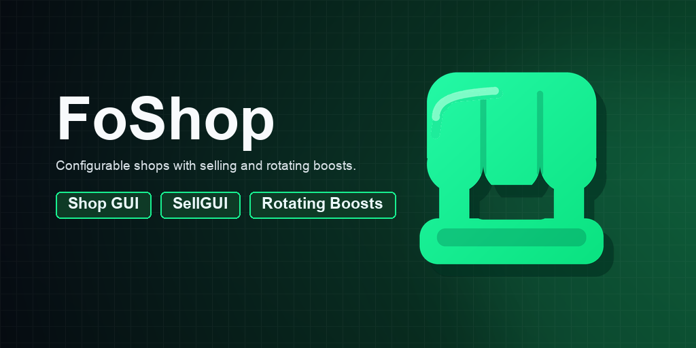
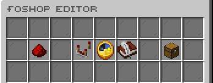
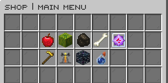
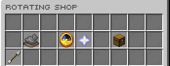
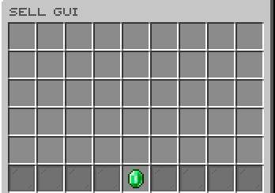

# FoShop

  

GUI economy shops with buying, selling, rotating offers, and sell boosters.

*Developed by Carrotio.*

## Features

- Provides configurable GUI shops for buying and selling items.
- Includes SellGUI, sell-all, sell-hand, worth browsing, and rotating offers.
- Supports global prices, shop sections, stock presentation, and configurable interfaces.
- Provides personal, team, and global sell boosters through a public API.
- Includes conversion tools for supported third-party shop formats.

## Download and dependencies

Download the latest compatible version from [Modrinth](https://modrinth.com/plugin/foshop). Check the [versions page](https://modrinth.com/plugin/foshop/versions) for supported Minecraft versions and server platforms.

- **Required:** None
- **Optional integrations:** `Vault`, `PlaceholderAPI`, `FoTeams`, `packetevents`

## Screenshots

*Configure FoShop in game.*

*Browse the main shop.*

*View rotating offers.*

*Sell items through SellGUI.*

## Support

For help or issue reports, join the [Carrotio Discord server](https://discord.gg/kEF77QCfu7).

<strong>Commands and permissions</strong>

### Commands

- `/foshop` — Opens the FoShop main shop GUI Aliases: `/shop`.
- `/foshopadmin <version|reload|editor|booster|rotatingshop reset|convert <ShopGUIPlus|EconomyShopGUI> [dryrun]>` — FoShop admin command Aliases: `/shopadmin`.
- `/rotatingshop` — Opens the FoShop rotating boosted shop GUI Aliases: `/rshop`.
- `/fosellgui` — Opens the FoShop sell GUI Aliases: `/sellgui`.
- `/sell [all|hand|gui]` — Opens SellGUI or sells inventory/hand items
- `/sellall` — Sells all sellable items in your inventory
- `/sellhand` — Sells the item in your main hand Aliases: `/sellheld`.
- `/worth` — Opens the FoShop worth browser Aliases: `/prices`.

### Permissions

- `foshop.use` — Allows using /foshop Default: `true`.
- `foshop.sellgui.use` — Allows using /fosellgui Default: `true`.
- `foshop.rotatingshop` — Allows using /rotatingshop Default: `true`.
- `foshop.sellall` — Allows using /sellall Default: `true`.
- `foshop.sellhand` — Allows using /sellhand Default: `true`.
- `foshop.worth` — Allows using /worth Default: `true`.
- `foshop.admin` — Allows using /foshopadmin and receiving admin update notices Default: `op`.

<strong>PlaceholderAPI</strong>

This plugin does not register public PlaceholderAPI placeholders.

<strong>Configuration</strong>

- `config.yml` — Main behavior and feature settings.
- `global-sell-prices.yml` — Shared global sell prices.
- `messages.yml` — Player-facing messages and interface text.
- `sounds.yml` — Configurable interaction sounds.
- `guis/*.yml` — GUI layouts, slots, labels, and lore.
- `shops/*.yml` — Shop section and item definitions.

Main config areas: `colors`, `file-logging`, `native-dialogs`, `rotating-shop`, `sell-boosters`, `global-sell-prices`, `sellgui`.

<strong>Developer API</strong>

`FoShopSellBoostApi` is registered with Bukkit's services manager and supports personal, team, and global multiplier boosts.

~~~java
FoShopSellBoostApi api = Bukkit.getServicesManager().load(FoShopSellBoostApi.class);
if (api != null) {
    api.setGlobalMultiplierBoost(this, "event", 2.0, 3600L);
}
~~~

