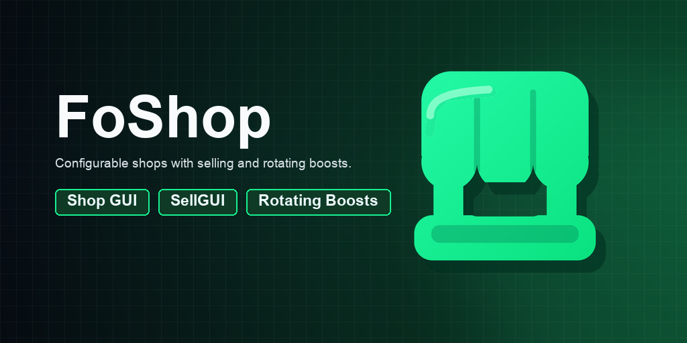
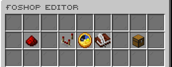
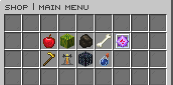
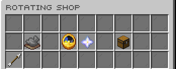
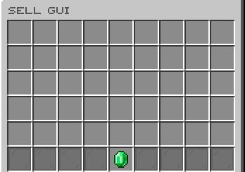

# FoShop

[](https://modrinth.com/plugin/foshop) [](https://modrinth.com/plugin/foshop/versions) [](https://discord.gg/kEF77QCfu7)

GUI economy shops with buying, selling, rotating offers, and sell boosters.

*Developed by Carrotio.*

## Features

- Provides configurable GUI shops for buying and selling items.
- Includes SellGUI, sell-all, sell-hand, worth browsing, and rotating offers.
- Supports global prices, shop sections, stock presentation, and configurable interfaces.
- Provides personal, team, and global sell boosters through a public API.
- Includes conversion tools for supported third-party shop formats.

## Download and dependencies

Download the latest compatible version from [Modrinth](https://modrinth.com/plugin/foshop). Check the [versions page](https://modrinth.com/plugin/foshop/versions) for supported Minecraft versions and server platforms.

- **Required:** None
- **Optional integrations:** `Vault`, `PlaceholderAPI`, `FoTeams`, `packetevents`

## Screenshots



*Configure FoShop in game.*



*Browse the main shop.*



*View rotating offers.*



*Sell items through SellGUI.*

## Support

For help or issue reports, join the [Carrotio Discord server](https://discord.gg/kEF77QCfu7).

<details>
<summary><strong>Commands and permissions</strong></summary>

### Commands

- `/foshop` — Opens the FoShop main shop GUI Aliases: `/shop`.
- `/foshopadmin <version|reload|editor|booster|rotatingshop reset|convert <ShopGUIPlus|EconomyShopGUI> [dryrun]>` — FoShop admin command Aliases: `/shopadmin`.
- `/rotatingshop` — Opens the FoShop rotating boosted shop GUI Aliases: `/rshop`.
- `/fosellgui` — Opens the FoShop sell GUI Aliases: `/sellgui`.
- `/sell [all|hand|gui]` — Opens SellGUI or sells inventory/hand items
- `/sellall` — Sells all sellable items in your inventory
- `/sellhand` — Sells the item in your main hand Aliases: `/sellheld`.
- `/worth` — Opens the FoShop worth browser Aliases: `/prices`.

### Permissions

- `foshop.use` — Allows using /foshop Default: `true`.
- `foshop.sellgui.use` — Allows using /fosellgui Default: `true`.
- `foshop.rotatingshop` — Allows using /rotatingshop Default: `true`.
- `foshop.sellall` — Allows using /sellall Default: `true`.
- `foshop.sellhand` — Allows using /sellhand Default: `true`.
- `foshop.worth` — Allows using /worth Default: `true`.
- `foshop.admin` — Allows using /foshopadmin and receiving admin update notices Default: `op`.

</details>

<details>
<summary><strong>PlaceholderAPI</strong></summary>

This plugin does not register public PlaceholderAPI placeholders.

</details>

<details>
<summary><strong>Configuration</strong></summary>

- `config.yml` — Main behavior and feature settings.
- `global-sell-prices.yml` — Shared global sell prices.
- `messages.yml` — Player-facing messages and interface text.
- `sounds.yml` — Configurable interaction sounds.
- `guis/*.yml` — GUI layouts, slots, labels, and lore.
- `shops/*.yml` — Shop section and item definitions.

Main config areas: `colors`, `file-logging`, `native-dialogs`, `rotating-shop`, `sell-boosters`, `global-sell-prices`, `sellgui`.

</details>

<details>
<summary><strong>Developer API</strong></summary>

### Maven dependency example

Install the matching `FoShop-2.4.jar` locally if it is not in your Maven repository. These coordinates do not claim a published artifact. Use `provided` scope so the server supplies FoShop:

```xml
<dependency>
  <groupId>me.foesio</groupId>
  <artifactId>FoShop</artifactId>
  <version>2.4</version>
  <scope>provided</scope>
</dependency>
```

Compile against the FoShop jar as a provided dependency. For example, with Gradle:

```gradle
dependencies {
compileOnly files('libs/FoShop-2.4.jar')
}
```

Put the same FoShop jar in `libs/` for compilation; do not bundle it into your plugin. Add `softdepend: [FoShop]` to your `plugin.yml` when your integration is optional, or `depend: [FoShop]` when required. Keep references to FoShop classes in a separate integration class that loads only when FoShop is enabled. Reacquire the service after a provider reload; it is unregistered on disable.

```java
if (Bukkit.getPluginManager().isPluginEnabled("FoShop")) {
    FoShopMarketApi market = Bukkit.getServicesManager().load(FoShopMarketApi.class);
    if (market != null) {
        market.getSellUnitPrice(player, player.getInventory().getItemInMainHand())
                .ifPresent(price -> player.sendMessage("FoShop pays " + price + " per item"));
        market.openSection(player, "blocks");
    }
}
```

`FoShopMarketApi` is registered after FoShop's shops, economy, GUI, and rotation services initialize. Its calls are synchronous and intended for the Bukkit server thread; Folia region-thread use is not promised. The price query returns one item's effective price, including temporary overrides, sell boosters, and rotation. It returns empty for an unsellable item or a container item, whose contents require separate recursive processing. Catalog queries return immutable snapshots: `getSections(player)` includes enabled sections and products visible to that player, with configured base prices, current stock, and remaining buy limit; `getGlobalSellPrices()` includes enabled global material, potion, and enchantment listings without player-specific effects. `-1` stock or limit means unlimited. A quote is current state, not a reserved price or guarantee that a later transaction succeeds.

`openSection` returns false for an offline player, missing permission, missing or disabled section, or unavailable public GUI. `getRotatingOffers()` and `getNextRotationAtMillis()` expose effective rotation state. `rotateNow(requester)` returns false when rotation is disabled or the requester is disabled; true means a reset ran, even if it selected the same offers.

`setTemporarySellPrice(owner, id, template, unitPrice, durationSeconds)` replaces the **base** sell price for an otherwise sellable item exactly similar to the template (amount is ignored), before boosters and rotation. The most recently set matching override wins. Price must be finite and nonnegative; duration must be positive. A zero price makes the item unsellable while the override applies. Overrides are scoped to owner plugin plus id, live only in memory, expire automatically, and disappear when the owner disables or FoShop stops. Remove them explicitly when no longer needed. They do not edit shop files or make an unlisted item sellable.

### Events

Register Bukkit listeners in the normal way. Events run synchronously on the context that performs the action; inspect `isAsynchronous()` and schedule any follow-up world/player work on its correct owning context. FoShop currently supports its normal Bukkit/Paper execution model and does not promise Folia region safety.

| Event | Timing and meaning |
| --- | --- |
| `FoShopPrePurchaseEvent` | After FoShop validates price, stock, limit, permissions, balance, and space; before withdrawal or delivery. Provides a copied item template for item products; command and permission products return null. Cancellation makes no purchase changes. A cancelling listener should provide player feedback. FoShop checks mutable state again after listeners return. |
| `FoShopPurchaseCompletedEvent` | After successful withdrawal, delivery, and purchase-limit recording. Quantity is what FoShop delivered; total price is the actual net charge if a partial refund succeeded. For command products, this means FoShop dispatched the configured commands, not that their external effects were verified. |
| `FoShopPreSaleEvent` | Once per sell GUI, hand, or all batch, after pricing but before source items are removed. The quoted sale is fixed for this attempt. Cancellation leaves hand/inventory or open-GUI inputs untouched; inputs are returned to the player when the GUI is closing. A cancelling listener should provide player feedback. |
| `FoShopSaleCompletedEvent` | Once after Vault accepts the earnings deposit. Contains sold-item copies, total sold units, actual earnings, and sale source. Failed or empty sales do not fire it. |
| `FoShopRotationChangedEvent` | After effective rotating offers change through a timed, admin, API, or reload reset. Contains previous/current immutable offers and next reset time. Restoring startup state does not fire it. A disk write failure can leave effective memory state changed, so this event does not promise durability. |

No event exposes FoPluginCore or FoShop's mutable manager objects. Sold item lists contain defensive `ItemStack` copies; catalog item stacks are copied on access. Purchase-limit persistence and rotation-state writes are best effort, so completed events report effective FoShop state, not a durable commit guarantee.

### Event listener example

Inside a Bukkit `Listener` registered by your plugin (import this event class, `org.bukkit.event.EventHandler`, and `org.bukkit.Bukkit` where used):

```java
@EventHandler
public void onFoShopPrePurchase(FoShopPrePurchaseEvent event) {
    Bukkit.getLogger().info("Shop product requested: " + event.getProductId());
}
```

### Complete public API method index

Signatures use short type names; import Fo types from this plugin's `api` package and Bukkit types from Bukkit.

#### `FoShopMarketApi`

```java
OptionalDouble getSellUnitPrice(Player, ItemStack);
List<FoShopSectionSnapshot> getSections(Player);
List<FoShopGlobalPriceSnapshot> getGlobalSellPrices();
List<FoShopRotatingOffer> getRotatingOffers();
long getNextRotationAtMillis();
boolean openSection(Player, String);
boolean rotateNow(Plugin);
boolean setTemporarySellPrice(Plugin, String, ItemStack, double, long);
boolean removeTemporarySellPrice(Plugin, String);
int removeTemporarySellPrices(Plugin);
```

#### `FoShopSellBoostApi`

```java
boolean setPlayerMultiplierBoost(Plugin, String, UUID, double);
boolean setPlayerMultiplierBoost(Plugin, String, UUID, double, long);
boolean setTeamMultiplierBoost(Plugin, String, String, double);
boolean setTeamMultiplierBoost(Plugin, String, String, double, long);
boolean setGlobalMultiplierBoost(Plugin, String, double);
boolean setGlobalMultiplierBoost(Plugin, String, double, long);
boolean setPlayerSellBoost(Plugin, String, UUID, double);
boolean setTeamSellBoost(Plugin, String, String, double);
boolean setGlobalSellBoost(Plugin, String, double);
boolean setBoost(Plugin, String, FoShopSellBoostScope, String, double);
boolean setMultiplierBoost(Plugin, String, FoShopSellBoostScope, String, double, long);
boolean removeBoost(Plugin, String);
int removeBoosts(Plugin);
boolean hasBoost(Plugin, String);
double getEffectiveSellMultiplier(Player);
```

**Other public contract types:** `FoShopGlobalPriceSnapshot`, `FoShopProductSnapshot`, `FoShopRotatingOffer`, `FoShopSaleSource`, `FoShopSectionSnapshot`, `FoShopSellBoostScope`.

### Complete Bukkit event index

- `FoShopPrePurchaseEvent`.
- `FoShopPreSaleEvent`.
- `FoShopPurchaseCompletedEvent`.
- `FoShopRotationChangedEvent`.
- `FoShopSaleCompletedEvent`.

</details>
